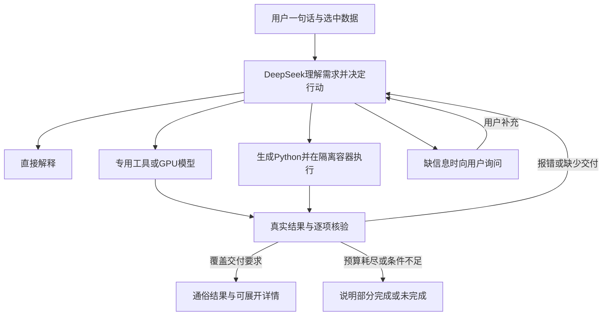

# 自主Agent：回答、工具、代码与逐项验收

本分支现用于交付最新应用开发基线。首次拉取和新统一模型API联调请以[开发者启动说明](developer-setup.md)为准；下文“未提交/未推送”等文字是当时开发过程的历史快照，当前发布状态需核对GitHub分支与交付提交。

FIX-025完成四项本地实现：统一自主调度、隔离代码执行与修复、数据理解与适配、按用户需求验收。新入口为 `python main.py --autonomous-agent --port 7864`。旧默认角色链和 `--tool-agent` 路径保留；启动旧入口不会自动切换成新流程。

本批基于修改前171份源码与文档的哈希快照开发，当前分支 `codex/autonomous-task-agent`，HEAD仍为 `21151579da66cc804641041f80289ebb0fbbf237`。继承的未提交整合内容未丢弃。本轮仅本地修改，提交、推送、PR、审批、合并均未执行；远端main不因此包含本批功能。[图文幻灯片](fixes/2026-10-29-025-autonomous-agent.html)保留本批行为与验证快照。

## 四项变化

| 项目 | 此前的工具预览 | 新自主入口 |
|---|---|---|
| 1. 调度 | 多角色交接后，从12个固定工具中选择；纯文本不能结束 | 同一个DeepSeek持续决策，可直接解释、调用专用模型/工具、生成Python，或组合这些方式 |
| 2. 执行与修复 | 无通用代码工具；工具错误回传 | 新增断网Linux容器Python执行，实际错误、输出与核验问题返回同一模型；有限修复后重新执行 |
| 3. 数据理解 | 模型工具主要要求固定尺寸与编码 | 读取真实波段、坐标、NoData及显式来源信息；核对编码并自动准备、原分辨率分块、拼接恢复；提供网格对齐 |
| 4. 验收 | 主要检查文件存在、可读和统计一致 | 保留原需求与修订，逐项检查要求的图、表、单位、输入覆盖；独立重算面积和逐波段均值；未完成项直接显示 |

普通用户只需选择影像并发送一句话。无需先选算法，也无需再输入 `approve`。对于解释性问题可以不选影像。只有缺失信息确实影响任务时才询问；回答后继续原任务。原始需求、有序修订、已生成产物及代码尝试数会保留。已结束任务需要新建对话，避免覆盖旧任务。

## 启动与准备

沿用 `environment.yml` 创建的Conda环境与原DeepSeek API配置；不更换服务商，不在宿主环境用pip覆盖GDAL/Rasterio。

通用代码需要Docker Desktop的Linux容器引擎及本项目镜像。首次准备在项目根目录、激活 `ursa-up` 后运行：

```powershell
docker desktop start --detach
python deploy/python_runtime/prepare.py
```

该脚本显式构建 `docker.io/library/ursa-python-runtime:1`，会下载官方Python基础镜像和固定版本依赖。正常分析不会自行构建、联网安装或拉取镜像。本批开发机器已经完成准备，无需每次重建。

日常启动：

```powershell
python main.py --autonomous-agent --port 7864
```

打开 `http://127.0.0.1:7864`，顶部应显示“自主Agent”。远程TerraMind/Prithvi仍使用原 `gpu.local.json` 和私有SSH转发；原GPU服务及模型权重不需要更新。Docker负责本机通用Python，专用GPU模型仍在4090D服务中执行。

CLI使用同一处理循环，输入名称为 `data/` 内的相对文件名：

```powershell
python main.py --autonomous-agent --cli --input terramind_demo_01/image.tif
```

也可在自己的 `config.json` 的 `tool_agent` 中设置 `autonomous: true`；默认仍为false。推荐使用显式启动参数，便于辨认当前入口。当前脚本支持Python，未开放Shell、包安装或任意宿主目录访问。

## 一句话测试

| 选中数据 | 用户提示词 | 应检查的结果 |
|---|---|---|
| 不选数据 | NDVI是什么，简单解释一下 | 直接说明，无虚构的影像计算或空下载区 |
| 一幅TIFF | 统计每个波段均值，只要CSV，不要图片 | 当前影像的逐波段统计表；不要求结果图，数值从原图独立重算 |
| `terramind_demo_01/image.tif`及同目录元数据 | 找出这张影像中的农田，给我候选分布图和平方米面积。 | 当前农作物候选图、面积、图和面积两项完成情况；保留“候选、尚未独立验证”的说明 |
| 缺热红外的Sentinel-2或RGB | 帮我看看哪里比较热 | 说明缺测温观测与校正条件；不把普通颜色变成实测温度 |
| 两幅有真实坐标的影像 | 对齐这两幅影像后，计算前后植被指数差并出图。 | 先核对波段和时相；必要时对齐，再计算和交付。缺日期/波段条件时询问；当前没有通用变化检测精度保证 |

模型并非按这些示例的关键词固定走某条算法。专用任务没有现成工具时，仍可尝试已安装库能完成的代码计算；代码不能补出缺失的物理观测、训练权重或参考答案。去云、任意目标检测等能力没有因增加执行器就自动获得可靠算法。

## 自主循环和预算

新提示词位于 `prompts/autonomous_agent_prompt.txt`。旧 `prompts/tool_agent_prompt.txt` 继续约束旧 `--tool-agent` 入口。



默认每个决策回合最多12次模型请求、24次工具调用、300秒、每次响应4096 token；实际仍受API耗时和在途请求超时影响，300秒不是强制中断所有第三方请求的硬截止。可在 `config.example.json` 所示字段范围内调整。代码尝试最多4次，单次最多60秒。达到上限、用户终止或缺必要观测会停止；不会无限重试。成功工具调用在同一回合内复用；跨澄清回合不保证复用成功调用缓存，可能重新推理。

错误返回包含真实stderr或工具错误及下一步建议。DeepSeek可以改代码、改合法参数或换方法，不能删用户要求、修改原始输入或降低核验标准来“通过”。多次失败仍应诚实报告，能力边界不会由循环本身消失。

## 注册的工具和接口

保留旧12项：`inspect_data`、`list_capabilities`、`extract_water`、`classify_landcover`、`retrieve_temperature`、`compute_index`、`select_classes`、`calculate_area`、`summarize_raster`、`render_map`、`validate_artifacts`、`finish_task`。

新增4项：

| 工具 | 契约 |
|---|---|
| `set_task_plan` | 记录回答/分析方式、目标和逐项要求；不能删除用户已明确要求 |
| `run_python` | 完整Python、批准的输入/当前产物ID、显式输出声明；路径从 `URSA_INPUTS_JSON` 读取，产物写入 `URSA_RESULTS_DIR` |
| `align_raster` | 对齐参考网格，或将小范围结果转为当地UTM；分类最近邻，连续值双线性 |
| `request_clarification` | 保存原任务，询问关键缺失信息，等待补充；不要求用户选择技术参数 |

共享变更：`Session.autonomous_state` 及GUI快照增加当前目标、验收、待补信息和用量；`result_delivery.requirements` 供前端逐项显示。`ToolCallLoop`新增可选文本结束、审计回调和参数长度配置，默认旧模式行为保持。GUI和CLI共用 `tools/autonomous_workflow.py`。

## 数据适配与物理边界

- 当前网页输入以TIFF为主，一次最多8幅、原上传大小限制保留。新增能力没有增加任意遥感格式读取器。
- 检查真实尺寸、波段描述、dtype、NoData、坐标、分辨率、scale/offset及显式元数据。缺失传感器、波段顺序或编码不凭文件大小猜测。预检有效范围取最多32波段、128×128缩略样本，不作为精确覆盖率。
- TerraMind适配显式Sentinel-2 L2A十二波段；Prithvi适配显式L1C十三波段。确认来源后才能重排波段、在DN/10000与0～1反射率之间转换，避免重复缩放。
- 保持原分辨率：TerraMind以224像素块、重叠32；Prithvi以512像素块、重叠64处理，边缘补NoData。重叠多数投票，同票按较小编码，拼接回原坐标与尺寸。当前每幅不超过400万像元、20波段、64块。
- 最终核验独立从原图重做适配检查，从已保存GPU原始返回包重建拼接；不会为核验再发GPU请求。原始输入文件不改写。
- `align_raster`只处理已知坐标的重投影/网格对齐，不等于精细影像配准。自动UTM仅用于纬度[-80,84]且经度跨度不超过6°的小范围数据；更大范围需明确合适投影。
- 普通RGB/Sentinel-2缺少热红外，不能凭代码给出实测LST。原Landsat温度工具所需大气辅助量、发射率与常数要求仍保留。

## 生成代码执行边界

执行器只挂载本次批准文件的只读副本、生成代码及本任务可写输出目录，不挂载项目、配置、参考答案、Docker socket或宿主个人目录。容器非root、断网、根文件系统只读、无额外capability，1 CPU、1GiB内存、64进程。可用NumPy、Rasterio、Matplotlib、Pillow、标准库，含中文字体；无容器内GPU和在线安装。

单文件有64MiB硬上限；日志每路64KiB、输出总计64MiB及128项由监测与退出后检查限制，**总目录大小不是文件系统硬配额，可能短暂超出后被终止**。超时或取消会清理自己的容器。Docker不是完整多租户安全边界，服务仍限本机私有使用。

运行时不可用时返回明确错误；不会静默在宿主机执行Python。输出仍需通过文件类型、真实可读性、像元/单位/来源等核验。栅格应继承输入或当前中间产物网格，或是整数像元裁剪；重投影先使用对齐工具。无输入不能生成假遥感结果。

## 完成检查与记录

程序从原需求和有序修订建立交付要求，DeepSeek可以补充计划。核验分别检查当前输入覆盖、图片/表格/栅格、要求单位、数值和来源。面积独立数分类像元并按米制投影计算；逐波段均值独立读取原图重算。CSV不能靠填假数、N/A或控制台声称成功来通过。只交付CSV时允许引用本次未下载的中间栅格作计算证据。

`completed`必须满足已识别要求；`partial`保留未完成项。解释回答、等待补充、部分完成和执行失败有不同展示。未知自然语言语义和类别准确性无法全部靠规则证明；“交付完成”仍不等于“识别正确”。无参考答案时不生成准确率百分比。

每个新任务独立使用 `results/task_.../`，同任务代码重试复用目录。记录包括：

- `autonomous_manifest.json`：输入身份、计划、产物、模型/代码运行、验收、实际调用用量。
- `journal/run_001.jsonl`及后续回合：每次实际请求的消息、assistant正文/工具参数和工具返回；认证字段不记录，`reasoning_content`不落盘。
- `step_*/`：生成代码、stdout/stderr、执行收据、当前产物；GPU块原始返回包与适配清单。

日志包含用户需求、文件名和模型正文，仍属于本地私有结果，不提交Git。运行端不读取评分答案；外部独立评分继续按[交卷后评价说明](blind-assessment.md)处理。已有评分器只支持其已定义任务/方法，新自主组合不会自动获得全部方向的外部评分。

## 修改文件与验证

| 文件 | 改动 |
|---|---|
| `tools/autonomous_workflow.py`、`tools/autonomous_tools.py` | 新统一调度、16项能力、实际错误回传、逐轮日志与通俗交付 |
| `tools/python_runtime.py`、`deploy/python_runtime/` | 独立Linux代码执行和显式准备脚本 |
| `tools/data_adapter.py`、`tools/model_adapter.py` | 来源检查、模型输入适配、分块拼接、网格对齐与原始返回重建核验 |
| `tools/task_acceptance.py` | 原需求逐项验收及独立数值重算 |
| `prompts/autonomous_agent_prompt.txt` | 新自主提示词，允许直接答、工具、代码及组合 |
| `core/tool_call_loop.py`、`core/session.py` | 可选纯文字结束、工具审计、澄清终止动作及会话状态 |
| `tools/tool_agent_workflow.py`、`tools/registry.py` | 新开关和独立16工具schema；旧12工具保持 |
| `main.py`、`config.example.json` | GUI/CLI新入口、输入参数与默认配置 |
| `gui/app.py`、`gui/templates/index.html` | 直接发送、待补信息恢复、入口标识、逐项完成清单、现有DeepSeek状态联动 |
| `tests/test_autonomous_agent.py`、`tests/test_autonomous_requirements.py`、`tests/test_gui_polling.js` | 新36项Python和2项网页回归 |
| 本说明、README、迁移说明、修改记录索引与FIX-025幻灯片 | 使用、边界、验证及图文留档 |

本批当前代码执行结果：

```text
python -X utf8 -m unittest discover -s tests -q
Ran 368 tests in 71.737s — OK
node tests/test_gui_polling.js
35 tests — 35 pass / 0 fail
git diff --check
通过
```

另外显式执行9项真实Docker检查：固定镜像、NameError后修复与CSV交付、独立均值重算、错误进入下一轮消息、非root/断网/只读及挂载限制、原输入未变、超时终止、退出后超量日志拒绝、中文绘图均通过。浏览器实际操作验证解释回答、CSV专用交付、4块地物拼接后的图与面积、缺热红外询问，以及390×844窄屏无横向溢出。

上述DeepSeek和GPU响应为模拟，影像为合成数据；Python实际在Docker执行。真实DeepSeek请求0、真实GPU推理0；没有据此宣称自主选路能力、所有任务语义或遥感模型精度已经通过实测。下一轮用户实测后，应检查逐轮调用、完成清单和独立评价，再决定继续扩模型或算法。
